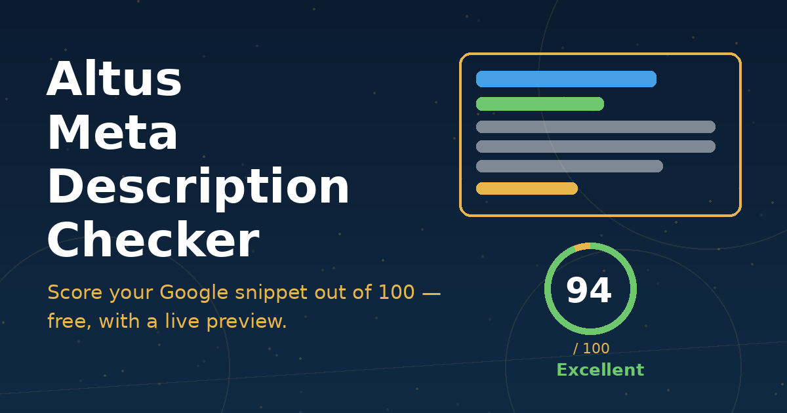

# Altus Meta Description Checker — Free WordPress Plugin

**A free meta description checker for WordPress: score any page's meta description out of 100 — length, pixel-width fit, keyword use and call to action — with a live desktop and mobile Google snippet preview. Fetch a live URL or paste your own text.**

> **⬇️ Download now:** get the latest release zip from the [**Releases page**](../../releases) → WordPress → Plugins → Add New → Upload Plugin → Install Now → Activate → add the shortcode `[altus_meta_checker]` to any page.

**Keywords people search for:** meta description checker, free meta description checker, check meta description, google snippet preview, serp preview tool, meta description length, meta description generator, seo meta checker, how long should a meta description be, wordpress seo plugin.

## What it does

Search for anything on Google and every result has the same anatomy: a blue title, a web address, and two lines of grey text underneath. Those two lines are the meta description — and for most small-business websites, they're an afterthought. The page got written, the title got written, and the description was left to chance.

That chance costs clicks. The meta description is your 155-character sales pitch, shown to every person who finds you on Google before they've seen a single pixel of your website. It doesn't directly change your ranking — but it decides whether anyone clicks.

Altus Meta Description Checker scores any description out of 100 in about thirty seconds. Paste a URL and it reads the live page, or paste your own draft title and description. You get a score with a plain-English grade, a live Google preview (desktop and mobile) cut exactly where Google would cut it, and twelve specific checks telling you precisely what to fix.

## Who it is for

- **Small-business owners** who want to know whether the words under their Google listing are winning clicks or losing them — and what to change, in plain English, without hiring an SEO consultant.
- **Bloggers and content creators** writing a new post who want to check the snippet before publishing, instead of discovering weeks later that Google cut it off mid-sentence.
- **Freelancers, web designers and agencies** who need a fast, repeatable snippet check for their own site or a client's — including a quick look at how a competitor's snippet reads.
- **Anyone who has ever wondered why Google rewrote their description** — the checks explain the usual reasons (too short, keyword-stuffed, identical across pages) one by one.

## The problem it solves

You can't just count characters. Google cuts descriptions by pixel width, not by character — a line full of wide letters (W, M) gets cut much earlier than a line of narrow ones (i, l, t). And if your description is missing, too short, or reads like keyword stuffing, Google simply writes its own from your page text — which may say nothing like what you wanted.

Most checkers count characters and stop there. This one measures the real width, flags the cut-off point, checks your keyword placement and call to action, and shows you the snippet as a searcher would actually see it — on desktop and on mobile.

## Features — and why each one matters

### A score that means something

- **Score out of 100 with a plain-English grade: Excellent (85+), Good (65+), Needs work (40+) or Poor.** Why it matters: a number alone doesn't tell you what to do next. The grade plus the twelve checks below it turn a vague "your SEO needs work" into a specific to-do list.
- **Live counters as you type** — description characters out of 155, title characters live. Why it matters: you see the length change while you write, instead of typing blind and checking afterwards.

### Fetch a live URL, or write your own

- **"Check a live URL" tab: paste any public page URL and the tool fetches it** and loads its title and meta description for you. Why it matters: checking your own live pages takes one paste, and checking a competitor's page takes the same — a quick way to see how your snippet stacks up against the listings around you.
- **"Write your own" tab: paste a draft title and description you're working on.** Why it matters: you can test a rewrite before you publish it, instead of publishing and hoping.
- **Guarded fetching:** the server-side fetch blocks private and reserved hosts (checked before the fetch and again after DNS resolution), is rate-limited to 5 fetches per IP per hour, and stores nothing it fetches. Why it matters: a URL-fetching tool that any visitor can trigger must not become a way to probe private networks — the guard keeps the tool safe to leave on a public page.

### A Google preview that shows the truth

- **Desktop and mobile SERP previews, toggled with one click.** Why it matters: most searches happen on phones, where the cut-off is narrower (~680 px instead of ~920 px). A description that fits on desktop can still be cut on mobile.
- **Preview cut where Google would cut it** — the description is truncated at the pixel width Google shows, and a note tells you when it was cut. Why it matters: you see the unfinished sentence your searchers would see, before they see it.
- **Pixel-width measurement from Arial glyph metrics**, calibrated so a typical 155-character description lands near Google's ~920 px desktop cut-off. Why it matters: character counting lies; width is what Google actually uses. Every width is labelled an estimate, and the fine print says Google rewrites descriptions — the tool is honest about its own limits.

### Twelve checks, each with a fix

- **Eight description checks: present, length, pixel-width fit, keyword placement, unique vs title, call to action, no shouting, clean ending.** Why each matters: a missing description hands the job to Google; a short one gets rewritten; a wide one gets cut; a buried keyword misses the bolding Google gives search terms; a description copied from the title wastes the space; a missing call to action leaves the searcher with no next step; all-caps reads as spam; and a description that ends mid-thought looks unfinished if it's cut slightly short.
- **Four title checks: present, length (~600 px), keyword, no shouting.** Why each matters: the title is half the snippet — a missing or cut-off title hurts just as much as a bad description, and the same keyword and shouting rules apply.
- **Each check is pass, warn or fail, with a plain-English explanation** — not a cryptic code. Why it matters: "Keyword included, but buried — move it nearer the start" is a job you can actually do; a red X with no words is not.

### Take the report with you

- **Copy my report button** — the full check as plain text on the clipboard. Why it matters: paste it into a document, an email to your designer, or your notes, without retyping anything.
- **Download report (.txt) button.** Why it matters: a saved copy of the check for your records, in a format that opens anywhere.
- **No email gate in this version.** Why it matters: the report is a copy button and a download, not a form. You get your results immediately, with no name and email address required.

## How it works

1. Add the shortcode `[altus_meta_checker]` to a page.
2. A visitor picks a tab: **Check a live URL** (paste a public page address and click Fetch page — the tool reads the page's title and meta description) or **Write your own** (paste a draft title and description, plus an optional target keyword).
3. They click **Check my snippet**. The tool scores the description out of 100, grades it, and shows the desktop and mobile Google previews plus the two checklists.
4. They read the specific fixes — length, keyword placement, call to action, shouting, title duplication — edit the text in the same form, and re-check until the score is where they want it.
5. They copy or download the report. Done.

The scoring runs entirely in the visitor's browser. The only server-side action is the optional public-URL fetch, which is guarded and rate-limited, and nothing fetched is stored.

## Installation (2 minutes, from the release zip)

1. Download the latest `altus-meta-description-checker-v1.0.0.zip` from the [**Releases page**](../../releases).
2. In WordPress, go to **Plugins → Add New → Upload Plugin**, choose the zip, click **Install Now**, then **Activate**.
3. Create or edit a page and add the shortcode: `[altus_meta_checker]`
4. Publish the page. Done — visitors can check meta descriptions from it.

## Frequently asked questions

**Is the Meta Description Checker really free?**
Yes. Every check, every preview and every report download is free, with no account needed.

**Does the meta description affect my Google ranking?**
Not directly — Google has said it isn't a ranking factor. But it strongly affects your click-through rate: the words searchers see decide whether they choose your listing or the one below it. More clicks on the same ranking means more business from the traffic you already have.

**Why does Google rewrite my meta description?**
Google rewrites descriptions it considers unhelpful — usually because they're missing, very short, stuffed with keywords, or identical across many pages. Writing a unique, honest 120–155 character description for each important page is the best way to keep control of what searchers see.

**How long should a meta description be?**
Aim for 120–155 characters, and keep the important words in the first 120. Google cuts by pixel width (about 920 pixels on desktop), not characters — wide letters eat more space. The tool measures both and shows you exactly where the cut lands.

**Are the pixel widths exact?**
They're close estimates based on Arial's font metrics, calibrated to Google's typical cut-off. Google renders snippets dynamically and sometimes shows different text, so treat the preview as a faithful approximation — not a pixel-perfect guarantee.

**Can I check a competitor's page?**
Yes — paste any public URL. It's a handy way to see how your snippet stacks up against the listings around you.

**Is the page I fetch stored anywhere?**
No. The fetch reads the page's title and meta description, returns them to your browser, and stores nothing on the server. Fetches are limited to 5 per IP per hour, and private/internal addresses are blocked.

**Should each page have a different meta description?**
Yes — at minimum, every page you want found on Google. Duplicate descriptions across pages are one of the main triggers for Google rewriting them.

## Honest limits

- **Pixel widths are estimates, not guarantees.** They are based on Arial glyph metrics, calibrated to Google's typical cut-off. Google renders snippets dynamically and sometimes shows different text — treat the preview as a close approximation.
- **Google may still rewrite your description.** A good score means your description is well written, not that Google is forced to use it. Unique, relevant, right-length descriptions are the best defence, but there is no way to force Google's hand.
- **The score is a guide, not a ranking.** A meta description is not a ranking factor. A 94/100 description on a page nobody finds still gets no clicks — the score measures the snippet, not the page's position.
- **Fetch needs a reachable public page.** Pages behind a login, blocked by robots rules, or returning an error can't be fetched — paste the title and description by hand instead. Fetches are limited to 5 per IP per hour.
- **Keyword checks need a keyword.** If you don't enter a target keyword, the keyword checks are simply skipped — the rest of the score is unaffected.
- **English-language assumptions.** The call-to-action words and shouting detection are built for English text; other languages may score oddly on those two checks.

## Changelog

### 1.0.0

First public release (stripped open-source version). Fetch a live URL (SSRF-guarded, rate-limited to 5/IP/hour) or paste your own title, description and keyword; score out of 100 with grade bands (Excellent 85+, Good 65+, Needs work 40+, Poor); live desktop/mobile Google SERP preview cut at Google's pixel width (~920 px desktop, ~680 px mobile); 8 description checks and 4 title checks with plain-English fixes; copy and download report; pixel-width estimates from Arial glyph metrics. Email delivery, lead storage and email sending removed — the full report is shown on screen and can be copied or downloaded. The scoring logic passed a 57-test Node harness and the PHP meta extraction passed an 11-test harness in the original build.

## What data does this tool handle?

This GitHub version contains NO lead capture, NO email sending, and NO data storage — results are shown on screen only. The version hosted on altuswebsolutions.com may offer email delivery; this open-source version does not.

The one exception is the public-URL fetch, stated plainly: when a visitor enters a public URL, the server fetches that page (via `wp_remote_get`) to read its `<title>` and meta description. That fetch is guarded — private and reserved IP ranges are blocked before the fetch and again after DNS resolution, localhost and internal hostnames are refused, and it is rate-limited to 5 fetches per IP per hour. The fetched content is returned to the visitor's browser and **nothing is stored**: no database table is created, no file is written on the server, no visitor data is kept, and nothing is transmitted to any external service other than the single fetch of the URL the visitor asked to check. The scoring itself runs entirely in the visitor's browser.

## Disclaimer

This software is provided free of charge, "as is", WITHOUT warranty of any kind, express or implied, including but not limited to the warranties of merchantability and fitness for a particular purpose. The authors are NOT liable for any loss, damage or cost arising from the use of this software, including but not limited to search rankings, click-through rates, or time spent installing it. Always back up your WordPress site before installing any plugin, and test new plugins on a staging site where possible. Pixel widths are estimates, not guarantees, and Google may rewrite any meta description regardless of its score.

## Licence

GPLv2 or later. See [LICENSE](LICENSE).
